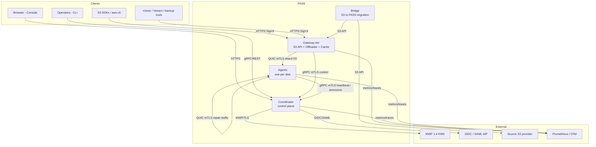
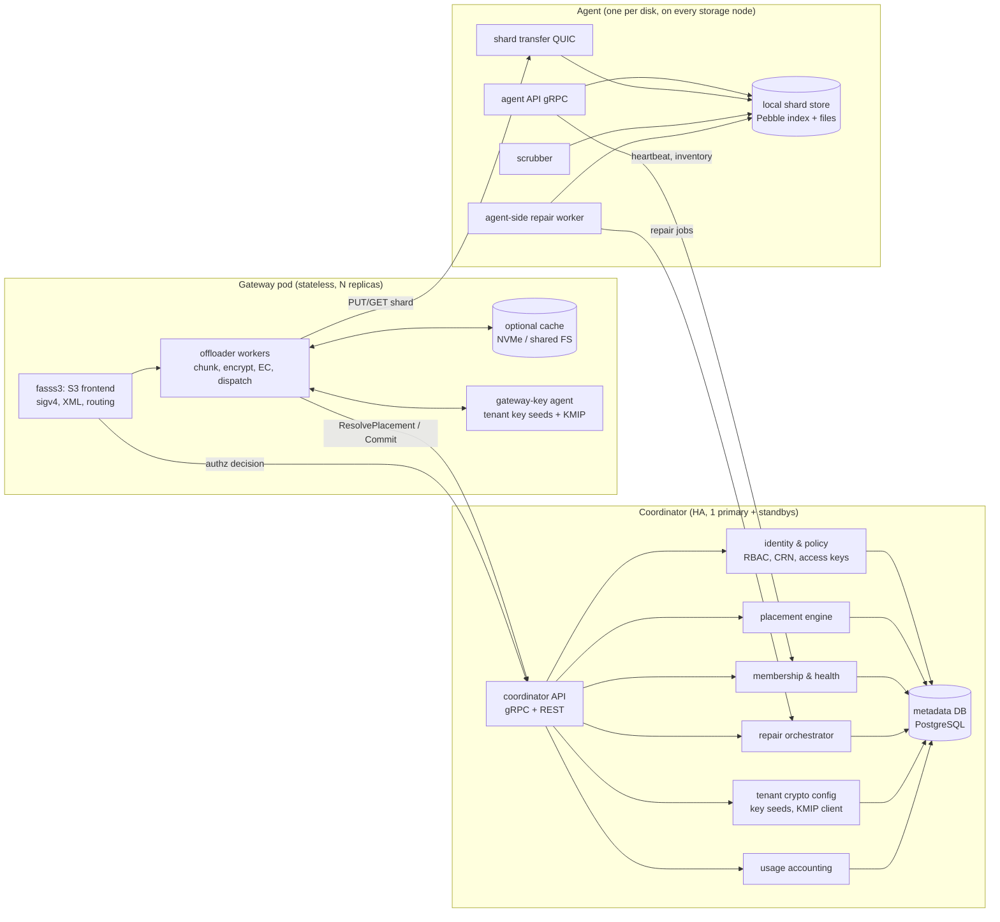
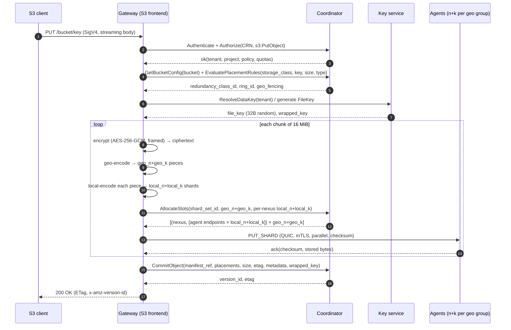
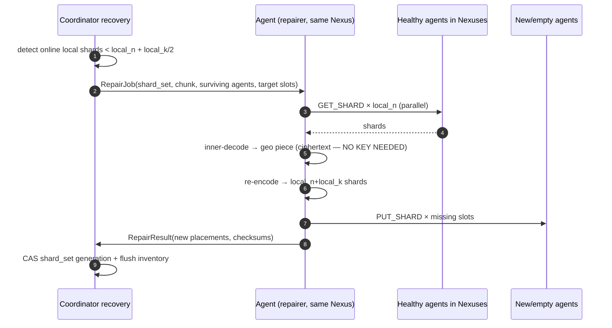
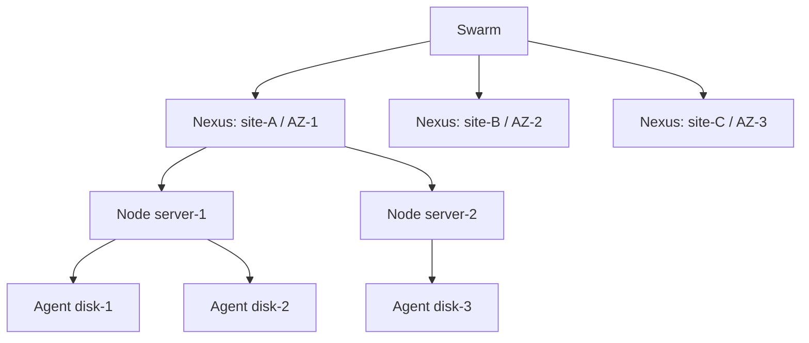

# 02 — High-Level Architecture (HLD)

**Project:** FASS — Federated Adaptive Storage Service, a Go clone of the Cubbit DS3 Composer architecture.
**Read after:** `01-reverse-engineering.md`.

---

## 1. What the system must do

### 1.1 Functional requirements

| ID | Requirement | Notes |
|---|---|---|
| F1 | S3-compatible API: bucket/object CRUD, multipart, versioning, object lock, ACL, tagging, `NoncurrentVersionExpiration` | Matches Cubbit's published matrix (`05-s3-api.md`) |
| F2 | Geo-distributed, policy-driven redundancy via **Redundancy Classes** (`geo_n, geo_k, local_n, local_k, aag`) | Two-tier hierarchical Reed–Solomon |
| F3 | Failure domains: Swarm → Nexus (AZ/site) → Node (server) → Agent (disk); AAG anti-affinity | |
| F4 | Geo-fencing / data residency: data must not leave a declared set of Nexuses | GDPR / sovereignty |
| F5 | Self-healing: local repair within a Nexus, geo repair across Nexuses, no re-read from client | Repair without keys |
| F6 | Multi-tenancy: Operator → Tenant → Project → Bucket, isolated quotas and policies | |
| F7 | Zero-knowledge mode; pluggable key sources (`single-key`, `local-multi-keys`, `remote-multi-keys` + KMIP) | |
| F8 | Smart Data Placement: rule engine routing uploads by storage class / key / size / content-type to a Redundancy Class | |
| F9 | Scale-out without downtime: add Nodes/Agents, add Rings, rebalance | |
| F10 | Migration: DS3-Bridge-equivalent transparent S3→FASS migration | |
| F11 | Observability, usage accounting (byte-hours, ingress, egress), audit log | |
| F12 | Pooled gateways with optional shared cache | |

### 1.2 Non-functional targets

| Attribute | Target | Basis |
|---|---|---|
| Durability | ≥ 11 nines design target (per-RC, computed in `03 §7`) | Cubbit's published target |
| Availability (data path) | 99.95% monthly for reads/writes at the gateway tier | Cubbit's published target |
| GET p99 (first byte, warm) | ≤ 250 ms intra-region for 1 MiB – 16 MiB objects | our SLO, not published by Cubbit |
| Throughput | saturate 2× 10 GbE per storage node | hardware baseline |
| Repair bandwidth | ≤ 5% of aggregate ingress cluster-wide, throttled | operational guardrail |
| Metadata durability | RPO 0 intra-region; RPO ≤ 5 min cross-region | beats Cubbit's advertised async DB-dump model |
| Max object size | 5 TiB; max single PUT 5 GiB; 10 000 parts | AWS-compatible limits |
| Chunk size | 16 MiB default, 4–64 MiB configurable per Redundancy Class | see `03 §2` |

### 1.3 Non-goals (v1)

* Wire-protocol or network interoperability with the real Cubbit Swarm.
* Reimplementing Cubbit's proprietary ML placement model.
* Bucket policies, CORS, website hosting, notifications, replication APIs, `SelectObjectContent` — Cubbit does not support them either (`05 §3`).
* Block/file protocols (iSCSI, NFS). Object only.
* Billing/payment. We ship usage *accounting*, not invoicing.

---

## 2. System context



**Control plane vs data plane is the central architectural rule.**

* The **Coordinator never sees a shard, a key, or plaintext.** It knows *where* data lives and *who* may touch it.
* The **Gateway never persists object data** (except an optional, evictable cache). It is stateless and horizontally scalable.
* **Agents never see keys or plaintext**, only ciphertext shards. Repair works on ciphertext.
* **Shard traffic is agent↔gateway and agent↔agent.** It does not transit the Coordinator.

---

## 3. Container view



### 3.1 Component inventory

| Component | Binary / package | State | Scales by | Cubbit analogue |
|---|---|---|---|---|
| Gateway frontend | `cmd/fass-gateway` + `internal/gateway/s3` | stateless | replicas behind LB | S3 Server (`gods3`) |
| Offloader | `internal/gateway/offloader` | stateless (bounded worker pool) | replicas; CPU-bound | Offloader |
| Gateway cache | `internal/gateway/cache` | optional NVMe/shared FS | per replica | Cache |
| Coordinator API | `cmd/fass-coordinator` | Postgres | vertical + read replicas | Coordinator |
| Placement engine | `internal/coord/placement` | pure function + DB | in-process | Coordinator placement |
| Membership/health | `internal/coord/membership` | DB + in-memory | in-process | Coordinator health |
| Repair orchestrator | `internal/coord/recovery` | DB queue | leader-elected | Coordinator recovery |
| Agent | `cmd/fass-agent` | local disk | one per disk | Agent |
| Agent repair worker | `internal/agent/repair` | local | one per disk | Agents P2P restore |
| Console | `cmd/fass-console` | stateless | replicas | Composer/DS3 Console |
| CLI | `cmd/fass` | none | — | `cubbit` CLI |
| Bridge | `cmd/fass-bridge` | migration jobs (DB) | workers | DS3 Bridge |
| Operator | `cmd/fass-operator` | K8s controller | leader | `gateway-operator` |
| Installer | `cmd/fass-installer` | files | — | Ansible recipes, `installer.sh` |

**Deployment modes** (same binaries):
1. **All-in-one dev:** `fass-coordinator --embedded-db --embedded-gateway`, 1 gateway + N agents via docker-compose.
2. **Composer-like production:** Postgres primary + standby, 2+ gateways behind L4 LB, agents as containers/systemd on storage nodes, k8s operator for gateways.
3. **Single-node eval:** coordinator gateway agent in one process (`fass all`) with a loopback transport.

---

## 4. Core data flows

### 4.1 Write path (`PutObject`)



Failure handling: if a shard write fails, the gateway retries on a replacement agent (slot displacement); if it cannot reach `local_n` per group, the chunk fails and the whole object is aborted, orphan shards are queued for GC via `upload_session` expiry.

### 4.2 Read path (`GetObject`, ranged)

```mermaid
sequenceDiagram
    autonumber
    participant C as S3 client
    participant G as Gateway
    participant CO as Coordinator
    participant A as Agents

    C->>G: GET /bucket/key (Range optional)
    G->>CO: Authorize + GetObjectManifest(key, version)
    CO-->>G: manifest(ring, rc, placements, checksums), wrapped_key
    G->>G: unwrap file key; map byte range → chunk indices
    par per chunk (pipelined, N ahead)
        G->>A: GET_SHARD to local_n agents in geo group #1 (hedged)
        G->>A: GET_SHARD to local_n agents in geo group #2
        A-->>G: shards + checksums
        G->>G: verify checksums → inner decode → geo piece
        G->>G: outer decode (any geo_n pieces) → ciphertext chunk
        G->>G: decrypt → plaintext
    end
    G-->>C: 200 / 206 streamed body
```

Optimisations specified: hedge requests after p95 of the fastest replica; skip whole `geo_k` groups (read `geo_n` only); cache hot shards in the gateway cache; per-chunk parallel pipeline with a bounded window (`readahead`).

### 4.3 Repair path (local, within a Nexus)



### 4.4 Geo repair (whole Nexus lost)

Assembled by a gateway (which has key-service access but *does not need it*): fetch `geo_n` surviving Nexus groups' worth of local shards → inner-decode each to its geo piece → outer-decode → re-outer-encode → local-encode → write into a replacement Nexus. Same blind property. The gateway is the natural actor because it already has chunk pipelines and cross-site bandwidth policy.

---

## 5. Consistency model

| Operation | Guarantee | Mechanism |
|---|---|---|
| `PutObject` then `GetObject` (same key) | **read-your-write, linearizable** | commit is a single DB transaction after all shards are durable; reads resolve metadata from primary |
| `PutObject` then `ListObjects` | linearizable | list served from primary; ordered index on `(bucket, key)` |
| Concurrent overwrite (unversioned) | last-writer-wins by commit order | row-level lock on `(bucket_id, key)` inside the commit txn |
| Versioned bucket | each PUT = new immutable version; previous becomes non-current | monotonic version id, `is_latest` flag flipped in same txn |
| `DeleteObject` | immediate metadata tombstone; **data GC is deferred** | tombstone + `deletion_queue` with grace period |
| Multipart | parts visible only via `ListParts` until `CompleteMultipartUpload`; completion is atomic | part records + atomic manifest assembly (no re-encoding of data) |
| Cross-gateway | identical (all gateways share the Coordinator) | stateless gateways |
| Cross-region DR | async metadata replication, RPO ≤ 5 min | Postgres streaming + WAL archive to DR site |

**Deliberate divergence from Cubbit:** Cubbit's docs are silent on consistency; we publish a stronger contract. Where Cubbit documents *inconsistency* (unverified checksums, no conditional writes) we choose correctness — see `05 §9` for the exact list and rationale.

### 5.1 Why shards are written before metadata commits
Shards are immutable and content-addressed by `(shard_set_id, shard_index)`. Writing them first and committing metadata last means a crash leaves *orphan shards* (garbage) but never a *dangling reference* (data loss). Orphan GC is a background sweep keyed on `upload_session` expiry — never on the read path. The invariant: **metadata is the only source of truth; unreferenced shards are always safe to delete.**

---

## 6. Failure domains and the durability contract



| Level | Failure | Handled by | Blast radius |
|---|---|---|---|
| Disk | agent process / disk failure | local RS (`local_k`), AAG prevents same-disk double placement | 1 shard |
| Node | server loss | AAG caps shards per node; local RS | ≤ `aag` shards |
| Nexus | site/AZ outage | geo RS (`geo_k`) | whole site's local group |
| Region | correlated disaster | additional RCs / separate Swarm / Bridge replication | policy decision |
| Coordinator | control-plane loss | Postgres HA + standby; data path degrades gracefully (below) | new placements/repair stall |

### 6.1 Coordinator-outage behaviour (explicit)
Public Cubbit docs do not define this. Our contract:

| Action during Coordinator outage | Behaviour |
|---|---|
| `GetObject` (metadata cached in gateway LRU) | **served** for cached entries; otherwise 503 |
| `PutObject` | **rejected** 503 (`ServiceUnavailable`) — no new placements |
| `DeleteObject` / listing | rejected (needs authoritative metadata) |
| Repair / rebalance | paused |
| Agent heartbeats | buffered, replayed on reconnect |

Rationale: never accept a write whose placement cannot be durably recorded. Gateways cache resolved manifests with a TTL (default 60 s) and a bounded LRU to serve hot reads during control-plane blips.

### 6.2 Redundancy economics (computed, not quoted)

`ratio = ((geo_n+geo_k)/geo_n) × ((local_n+local_k)/local_n)`.
Usable capacity = raw / ratio. Shard size per chunk = `chunk / (geo_n × local_n)`.

| Profile | geo | local | aag | Ratio | Usable per 1 PB raw | Tolerates |
|---|---|---|---|---|---|---|
| Single-site economical | 1,0 | 8,2 | 2 | 1.25× | 800 TB | 2 disks / 1 server |
| Single-site standard | 1,0 | 16,4 | 2 | 1.25× | 800 TB | 4 disks / 2 servers |
| **3-site geo (recommended)** | 2,1 | 16,4 | 2 | **1.875×** | 533 TB | 1 site + 2 servers/site |
| 3-site geo-resilient | 3,2 | 4,2 | 1 | 2.5× | 400 TB | 2 sites + 2 servers/site |
| Edge / 2-site | 2,1 | 6,3 | 2 | 2.25× | 444 TB | 1 site + 3 disks/site |
| Cubbit DS3-Cloud flat | 1,0 | 20,40 | 1 | 3.0× | 333 TB | 40 of 60 nodes |

---

## 7. Deployment topologies

### 7.1 Reference production (3 sites, 3 Nexuses)
* **Coordinator:** 3× small VMs (2–4 vCPU, 8 GB, 100 GB NVMe) — Postgres primary in site A, sync standby in site B, async standby in site C. Gateways are pointed at a floating endpoint.
* **Gateways:** 2+ per site behind an L4 load balancer, TLS terminated at the gateway (no re-encryption at LB). Shared cache over NFS/NVMe-oF if the workload is read-heavy.
* **Storage:** per site, ≥ 3 nodes × 12 disks. With `local 16+4, aag 2`, one Ring needs 20 slots; a 36-disk site (3 nodes) forms one Ring; site capacity grows by adding Rings.
* **Agents:** one container per disk, `--disk /dev/sdX --port 71xx`, 1 thread + 2 GB RSS each.

### 7.2 Single-site
`geo(1,0)` — the two-tier code degenerates; only local RS runs. Still gets full S3 API, versioning, repair. This is the "edge-optimised" profile.

### 7.3 Dev/eval
`docker compose up` → 1 coordinator (embedded Postgres), 1 gateway, 6 agents on loopback with tiny disks, RC `local 4+2`. Everything on 16 MiB chunks, 4 MiB test objects.

---

## 8. Technology choices (and why)

| Concern | Choice | Why not the alternative |
|---|---|---|
| Language | **Go 1.24+** | Cubbit's own gateway is `gods3`; single static binaries for on-prem; excellent concurrency for shard fan-out |
| Shard transport | **QUIC** (`quic-go`) with mTLS | gRPC/HTTP2 head-of-line blocking on many parallel shard streams; QUIC has per-stream flow control, 0-RTT resumption, connection migration |
| Control transport | **gRPC + protobuf** | typed contracts, streaming for inventory/repair |
| Erasure coding | `klauspost/reedsolomon` (GF(2⁸), SIMD, GFNI where available) | mature, handles up to 256 shards, `n+k=60` fits comfortably |
| Metadata store | **PostgreSQL 16** (primary + standby) | prefix/ordered listing, real transactions for atomic version flips, PITR; matches Cubbit's "master-slave + DB dump" HA model but stronger |
| Embedded/dev DB | SQLite (WAL) behind the same repository interface | zero-dependency `fass all` mode; not for production |
| Shard index (agent) | **Pebble** + raw files on disk | shard bytes are immutable: write-temp → fsync → rename; no WAL needed for payload |
| Config | YAML + env + flags, single `Config` struct, validated at boot | |
| Telemetry | Prometheus + OpenTelemetry + `slog` (JSON) | |
| Console | Go templates + HTMX + embedded `embed.FS` | no Node toolchain in the deploy path |
| K8s | controller-runtime operator, `Gateway` CRD | mirrors `gateway-operator` |

---

## 9. Architecture decision records (summary)

| # | Decision | Consequence |
|---|---|---|
| ADR-1 | **Two-tier EC is first-class**; flat coding is `geo(1,0)` | one code path; DS3-Cloud-style flat 20/60 is expressible |
| ADR-2 | **Encrypt-then-code** always | repair is blind; Coordinator and Agents never hold keys |
| ADR-3 | **Coordinator is centralised and stateless w.r.t. payload** | simple, auditable placement; Postgres HA bounds availability; documented degraded mode |
| ADR-4 | **Gateway does the crypto** (client-side at the edge) | zero-knowledge mode moves crypto into the SDK and the gateway becomes a pure proxy |
| ADR-5 | **Shards are immutable; metadata is the sole source of truth** | crash-safe commits; garbage-only failure mode |
| ADR-6 | **Deterministic placement + displacement log** | tiny metadata; rebalance becomes a planning problem, not a data rewrite |
| ADR-7 | **Stateless gateways, no sticky sessions** | any gateway can serve any object; LB can be round-robin |
| ADR-8 | **S3 semantics superset** of Cubbit where Cubbit is unsafe (checksums, conditional writes, `Content-MD5`) | better durability; fully documented divergence |
| ADR-9 | **Single binary per role, shared internal packages** | one build pipeline; `fass all` for dev; k8s/systemd for prod |
| ADR-10 | **No payload over the control plane** | Coordinator scales to metadata-only; no accidental data-plane bottleneck |

---

## 10. Risks and open questions

| # | Risk | Mitigation | Open question for the user |
|---|---|---|---|
| R1 | Metadata store becomes the bottleneck (every PUT commits) | batch commits per object; `fsync=off` on standby; partition by bucket | Acceptable? We can add a Raft-based sharded metadata later |
| R2 | Small objects: 3× amplification even at 16 MiB chunks | v2 small-object packing (log-structured packs) | Do you need sub-1 MiB object efficiency in v1? |
| R3 | Cross-site repair bandwidth spikes | throttled repair scheduler, per-link token buckets | Site interconnects: dedicated or internet? |
| R4 | Postgres failover = control-plane write outage (~30 s) | Patroni + sync standby; gateway retries | Preferred: Patroni, CloudNativePG, or managed DB? |
| R5 | Multi-tenant noisy neighbour | per-tenant/per-project token buckets at gateway and per-agent | |
| R6 | Object lock + lifecycle interactions | single source of truth in metadata; no shard GC while locked | |
| R7 | Range reads decode whole chunks | 16 MiB chunk bounds waste; optional 1 MiB "sub-chunk" reads | Is random-read latency or storage overhead more important? |
